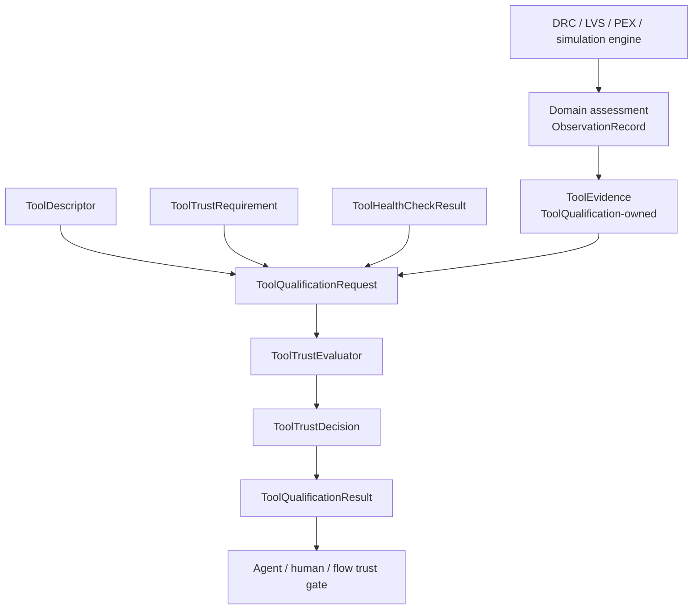

# ToolQualification Design Contract

## Purpose and Scope

This is the package design authority for the existing qualification library and
its headless CLI. Parent: [LSI](../DESIGN.md). Domain execution and physical-model
interpretation remain outside this package; no new policy service or execution
wrapper is introduced by the case-bound qualification contract below.

## Responsibilities and Boundaries

`ToolQualification` evaluates whether a tool is eligible for a requested flow
operation. It owns tool descriptors, capabilities, qualification levels,
evidence requirements, health-check interpretation, deterministic registry
selection, trust decisions, process-qualification evidence records, and the
headless CLI.

It never launches a tool. Domain engines produce domain assessments,
observations, artifacts, and provenance. This package validates those inputs,
builds qualification evidence, issues qualification records, and applies
fail-closed trust gates.

## Architecture



## CircuiteFoundation integration

The package depends on `CircuiteFoundation` for the shared artifact,
provenance, evidence, and diagnostic boundary. Clients import
`CircuiteFoundation` explicitly when they use those shared types:

- `ToolQualificationRequest` captures descriptor, requirement, health, input
  artifact references, and evaluation time.
- `ToolQualificationResult` carries the existing `ToolTrustDecision` together
  with Foundation artifact, diagnostic, and evidence surfaces.
- `ToolQualificationEngine` refines `CircuiteFoundation.Engine` for an
  asynchronous flow integration while the existing `ToolTrustEvaluator`
  remains independently usable and synchronous.

Project and run persistence is outside this package. Engine-facing evidence
uses Foundation types directly; Xcircuite supplies concrete persistence when a
flow needs `.xcircuite` storage.

## Trust boundary and ownership

| Concern | Owner |
|---|---|
| Shared artifact, provenance, evidence, and diagnostic types | CircuiteFoundation |
| Tool descriptors, capabilities, evidence freshness, trust decisions | ToolQualification |
| Native corpus/oracle and health execution | Domain engines / SignoffToolSupport |
| Tool process launching | SignoffToolSupport or domain adapter |
| Flow-stage ordering and approval gates | DesignFlowKernel |
| Project/run ledger and artifact persistence | Xcircuite / DesignFlowKernel |

## Deliberate non-goals

- No tool execution, parser, DRC/LVS/PEX algorithm, or foundry-rule database.
- No self-certification: a declared qualification level requires supporting
  evidence and freshness checks.
- No conversion of a process exit code into a passing trust decision.
- No project/run migration, filesystem persistence, or flow lifecycle.

## Concrete engine boundary

`DefaultToolQualificationEngine` is the concrete Foundation-facing engine. It
invokes the existing synchronous `ToolTrustEvaluator`, maps both evaluator and
health diagnostics to Foundation diagnostics without losing their original
codes, records request inputs and evaluation timestamps in
`ExecutionProvenance`, and returns a Foundation-backed result.

It preserves deterministic registry ordering, health and freshness gates, and
independence requirements. It does not launch tools or create qualification
evidence that was not supplied by the caller. CLI commands expose
domain-specific, typed records and diagnostics; they are not a persistence
contract for another package.

## Related Designs

| Design | Relationship | Contract Used | Summary | Cautions |
|---|---|---|---|---|
| [LSI](../DESIGN.md) | parent | Process evidence and domain ownership | System composition | Library availability is not process qualification |
| [CoreSpice](../CoreSpice/DESIGN.md) | coordinates with | Actual selected model and simulation evidence | Domain-generated observations | Model equations and extraction criteria remain domain-owned |
| [Xcircuite](../Xcircuite/Sources/Xcircuite/DESIGN.md) | used by | Evidence building, validation and retained references | Flow and artifact composition | Preserve all referenced inputs and original outputs |
| [ReleaseEngine](../ReleaseEngine/DESIGN.md) | used by | Validated process qualification scope | Separate release authorization | Human approval cannot replace missing execution evidence |

## Contracts and Invariants

`productionEligible` is derived from a complete process record, never from the
descriptor level. The record retains the exact tool and oracle binaries, PDK and
deck scope, corpus/oracle/health artifacts, and qualified input and output
artifacts. Primary and oracle executables and output artifacts must be distinct,
oracle metric comparisons are bound to both case outcomes, and operating-corner
coverage is promoted only from the intersection required of both corpus and
independent-oracle results. Every reference
carries SHA-256 and byte count. ToolQualification, domain packages, and
Xcircuite re-verify the referenced bytes before accepting it. Human approval is
owned by DesignFlowKernel and ReleaseEngine.

### Case-bound model promotion: required contract

Requested model coverage and executed model coverage have separate authorities.
The builder joins original executed cases before deriving its model claims;
the validator reconstructs that derivation without supplying the record's model
list as build-request coverage. Domain receipt emission and metric authority
remain separate completion obligations.

The build request owns the desired model coverage, not the truth of that coverage.
Domain case declarations own the exact input, model source and operating profile.
The actual domain executor owns receipts for the models it selected and consumed,
and the original case output containing its observations. A receipt must be
generated from actual preparation/binding or extraction, rather than by copying
the request, a case declaration or a coverage tag. Its exact source and execution
artifact references are retained and integrity-verified.

The independent oracle owns its separate execution and output for the same case
input and model meaning. Different executables or output paths do not substitute
for checking the case binding. The builder joins the corpus primary outcome and
the oracle comparison's primary outcome exactly, including input identity, model
receipts, metric identity and observed values. Oracle agreement is evaluated only
after that join. Conflicting duplicate cases, missing required cases, altered
receipts, unmatched original outputs and unsupported requested model claims fail
explicitly before producing qualified evidence.

Qualified model IDs are derived from passing, matched primary/oracle case
bindings. Every requested model must be present in that derived coverage. A
loaded but unused model declaration is not a receipt. Coverage tags describe
cases and do not encode model identity. The validator recomputes the same joins
and derived claims from retained original artifacts, then compares the rebuilt
record with the supplied evidence. It does not treat the supplied model list as
independent proof. Operating-corner coverage keeps the existing aggregate
corpus/oracle contract; model binding does not introduce a per-case corner rule.

```text
Domain case declaration and exact inputs
    -> actual primary execution -> selected-model receipts and original output
    -> independent oracle execution -> separate receipts and original output
    -> exact corpus/oracle primary join -> passing comparisons
    -> derived model coverage -> qualified evidence -> independent rebuild
```

### Original execution and model receipt schema

`ToolQualificationCaseOutcome.originalExecutionArtifact` is required. Canonical
outcome, corpus, oracle, build-request and evidence schemas migrate together;
legacy outcomes without this binding are rejected rather than synthesized.

`ToolQualificationCaseExecution` is the retained original output envelope. It
contains the case ID, execution ID, producer, exact executable artifact, exact
input artifacts, completed phase IDs, metric-to-phase bindings, model-receipt
artifact references and observed metrics. Its
observations must equal the corresponding outcome. Its executable and producer
must match the relevant primary or oracle execution identity. Original outputs
and receipts belong to the output inventory; source and case inputs belong to
the input inventory. Every nested reference is integrity-verified.

Original executions and consumed-model receipts admit `.engine` and `.tool`
producer kinds through one shared rule. These identify executing domain API and
CLI producers, respectively; other kinds do not establish execution. Receipt
producer identity equals the original execution producer in full, while the
original execution identifier, version and executable match its scoped primary
or oracle identity. Qualification-result issuers remain separate assessments.

`ToolQualificationModelExecutionReceipt` contains the case ID, execution ID,
producer, phase ID, model ID, exact source artifact, selected model identifier,
consumed instances, exact input artifacts, optional declared model version and
resolved model-only numeric parameters. The consumed-instance dictionary maps
each actual instance ID to its effective numeric parameters. The domain owns
the meaning and completeness of both parameter sets, including effective
geometry and temperature when applicable.
Absent version information remains absent; the builder never infers a version.
Numeric parameters must be finite and duplicate or conflicting identities fail.
Only actually consumed instances establish model coverage.

| Canonical value | Schema version |
|---|---|
| Case outcome / original execution / model receipt | 2 |
| Corpus result | 4 |
| Oracle result | 5 |
| Process build request | 8 |
| Process evidence | 7 |

Receipt inputs equal their original execution's exact input set, which includes
the model source. Every original input and receipt must also appear in the
corresponding corpus/oracle inventory and the process inventory. This flattened
retention guarantee lets direct consumers retain `inputArtifacts` and
`outputArtifacts` without interpreting domain models. A model-free execution
retains empty receipts and derives no model claims; an unconsumed declaration
cannot supply desired coverage.

The corpus primary and the oracle's embedded primary must identify the same
original output and observations. Independent primary and oracle executions
retain distinct execution identities and original outputs. Their common case
inputs, model source, selected model meaning, version and resolved conditions
must agree; their execution-specific receipt bytes need not be identical.
The validator derives all covered model IDs from retained passing comparisons,
then compares the rebuilt evidence with the supplied record. Supplied model IDs
remain claims to verify, never a source of coverage truth.

These envelopes establish execution binding, not physical accuracy. Domain
emitters must produce receipts from actual preparation or extraction before
composed flow/release completion can be claimed.

### Phase-bound execution composition

DC points and Monte Carlo seeds can bind the same actual instance with different
effective parameters. A baseline binding snapshot cannot represent those runs.
The original case envelope must retain unique, completed domain phase IDs and
an explicit `metricPhaseIDs` binding for every observed metric. A DC aggregate
observation refers to all contributing points; a seed-local observation refers
only to that seed. Domain executors own phase conditions and identity, and retain
effective invocation, operating conditions and seeds as exact case inputs.

Each model receipt belongs to one phase and retains resolved model parameters
separately from a `consumedInstances` dictionary keyed by actual instance ID,
whose values are that instance's finite effective numeric parameters. The
dictionary is the sole consumed-instance inventory; phase IDs never alter
instance IDs. Duplicate consumption is rejected within the same phase/model/
instance tuple, while distinct phases may consume the same instance.

The builder verifies phase membership and complete metric-to-phase bindings,
and independently joins primary/oracle phase bindings and per-instance effective
parameters alongside existing model/source/input meaning. All retained phases
and receipts remain integrity-verified. Qualified coverage is derived only from
receipts in phases contributing to passing matched observations; an executed
but unobserved phase cannot promote a model. Unknown phases, duplicate
consumption, mismatched phase conditions or parameters, and missing observation
bindings fail before evidence publication. Canonical schemas migrate without a
legacy fallback. The former v1 envelopes describe only a case-wide binding and
cannot represent per-phase consumption; the mandatory schemas above require the
phase contract. `phaseIDs` is a nonempty unique canonical phase inventory.
`metricPhaseIDs` has exactly the observed metric keys; each value is a nonempty
unique subset of `phaseIDs`. Primary and oracle inventories and bindings agree.
Receipts outside the union of observed metric phases remain retained and
verified, but do not establish model coverage. Model-free phases are valid.

Behavioral evidence must accept the same instance with different parameters in
distinct phases, refuse duplicate consumption within one phase, refuse missing
or unknown phase and differing oracle instance parameters, and prove that an
unobserved phase cannot enlarge derived coverage. This migration changes
execution binding, not physical acceptance criteria.

### Metric criterion authority: required contract

The domain owns metric meaning, units, extraction conditions and admissible
operating domain. The application requirement owns the allowed error or circuit
limit. A retained criterion identifies both authorities and its reference data;
an output result cannot choose a more permissive tolerance for itself. The
builder verifies the criterion's input identity and case/metric applicability
before accepting a derived comparison. Shared validation must not reconstruct
semiconductor meaning from metric names or coverage tags.

| Assessment purpose | Required distinction |
|---|---|
| Implementation correlation | Same specified model and conditions across independent implementations; not measured process accuracy |
| Numerical convergence | Residual, discretization or timestep behavior; not a circuit specification |
| Physical-model validation | Disagreement against a suitable physical reference, with its uncertainty and operating domain |
| Circuit requirement | Application voltage, current, delay or waveform requirement, independent of comparison tolerance |

The criterion preserves absolute/relative comparison rules, near-zero handling,
reference provenance, units and extraction definition. Physical-reference
uncertainty preserves its components, correlations, aggregation method and
distribution/coverage assumptions. Calibration and held-out validation inputs
remain distinguishable. Neither a large uncertainty interval nor a solver
residual supplies an application acceptance threshold. Unknown physical limits
remain unavailable for physical qualification; they are not inferred from smoke
fixtures, published benchmark percentages or implementation agreement.

The source basis is [NIST IR8298 sections 4 and 5](https://nvlpubs.nist.gov/nistpubs/ir/2020/NIST.IR.8298.pdf),
[NIST TN1297 sections 5 through 7](https://physics.nist.gov/cuu/pdf/tn1297.pdf)
and [JCGM106](https://www.bipm.org/en/doi/10.59161/jcgm106-2012).
These establish assessment and uncertainty methods, not semiconductor-specific
acceptance limits. Physical equations and such limits remain domain/application
contracts.

## State, Ownership, and Lifecycle

Qualification requests, outcomes and records are Sendable values. Artifact
readers own bounded reads and close failures. Domain executors own execution
resources; this package does not acquire simulator or extractor lifetimes.
Record validation retains neither mutable domain state nor an implicit latest
model or criterion reference.

## Failure, Concurrency, and Constraints

Missing or inconsistent case bindings, insufficient requested coverage, changed
artifact bytes, unsupported schemas and unavailable criteria are explicit
failures. No path substitutes empty observations or a successful default model.
Model and criterion migrations update canonical schemas and direct consumers;
legacy artifacts without the required binding are not silently accepted.

## Verification and Change Impact

| Proof owner | Behavioral obligation |
|---|---|
| Qualification builder tests | Existing request-only model fixture becomes a refusal; executed requested models derive exact claims |
| Corpus/oracle tests | Reject a passing oracle primary with different corpus observations, inputs or model receipts |
| Evidence validator tests | Reject forged extra model IDs and altered/missing original case artifacts on independent reconstruction |
| Canonical schema and CLI tests | Preserve the complete binding and reject obsolete or incomplete artifacts |
| Domain executor tests | Prove receipts arise from the actual selected models, including version, geometry and failed admission |
| Xcircuite and ReleaseEngine | Retain all required references and refuse incomplete qualification at admission and release |

The case-binding implementation and metric-criterion implementation are separate
responsibilities. Their lower proofs precede composed flow/release verification;
passing either responsibility alone does not establish physical qualification.

## Declared execution identity

`ToolEnvironment.executionProducer` retains the caller's optional
`CircuiteFoundation.ProducerIdentity` independently of executable or library
paths. It participates in environment equality, hashing, and Codable round
trips. An absent producer is unknown; it is never inferred from assets, a path,
or a version. A current explicit producer therefore differs from a retained
environment with an absent or mismatched producer.

The domain adapter owns the meaning and measurement of `ProducerIdentity.build`
and the comparison against the actual execution. This value does not measure an
image, launch a tool, or establish independent process qualification. Existing
asset requirements remain separate. Xcircuite uses environment equality when
admitting retained qualification records; ReleaseEngine separately binds raw
execution evidence to its qualified process scope.

### Verification and change impact

`ToolEnvironmentExecutionIdentityTests` owns path-independent producer
serialization, equality and set membership, preservation of existing fields,
absent-identity decoding, and rejection of malformed producer tokens. Changes
to this contract require consumer record-adoption checks as well as the domain
adapter's actual measured-producer gate; neither proof substitutes for process
qualification.
